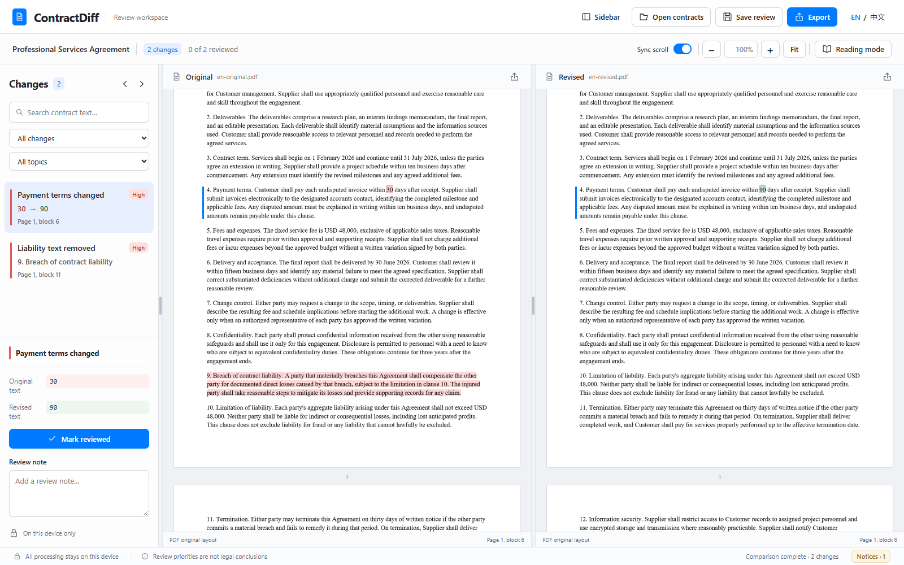
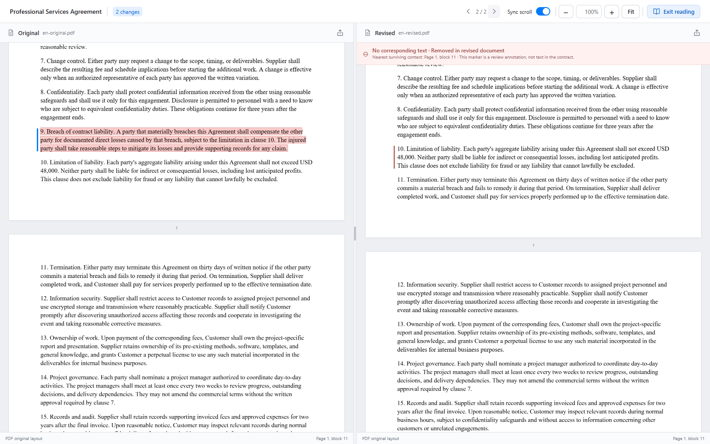
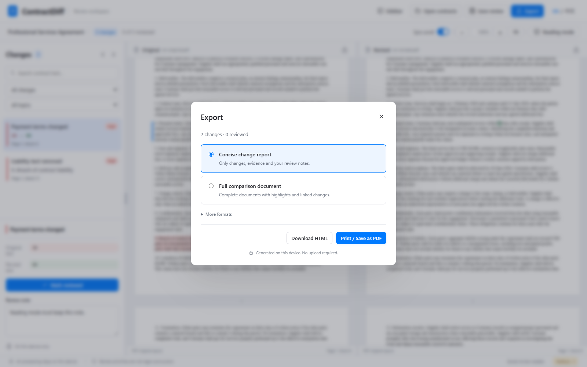

# ContractDiff

A private, offline workspace for comparing English and Chinese PDF/DOCX contracts. No account, paid API, server, or installation is needed to use the app.

## Features

- Compare additions, deletions, edits, reordered clauses, and table rows.
- Flag payment terms, amounts, dates, deadlines, penalties, liability, and termination changes.
- Review complete documents with original PDF layouts, formatted DOCX previews, precise highlights, and linked source navigation.
- Resize document panels, collapse the sidebar, synchronize scrolling, adjust zoom from 50–300%, or enter reading mode.
- Search and filter changes, add review notes, mark items reviewed, and explicitly save reviews locally.
- Process scanned PDFs with bundled English/simplified-Chinese OCR.
- Export concise change reports, full comparison documents, or the legacy text report as HTML or through Print / Save as PDF.

## Launch and use

1. Extract the **entire app ZIP**.
2. Double-click **ContractDiff.html** in Chrome or Edge. Keep the `dist` folder beside it.
3. Choose **Load sample**, or **Open contracts** to select two PDF/DOCX files and compare them.
4. Click a change to locate its source in both documents. Drag dividers to resize; use **Fit**, the zoom percentage, or **Reading mode** to read comfortably. **Escape** exits reading mode.
5. Add notes, click **Save review** to keep them in this browser, and use **Export** to create a report.

**Success check:** the English sample shows exactly two changes: payment changes from **30 to 90 days**, and the entire breach-liability clause is deleted. The missing side is explicitly labeled; no replacement clause is invented.

## Screenshots

### Review workspace

### Reading mode

### Export

## Privacy and accuracy

Contracts, OCR, comparison, and exports are processed on your device. Saved reviews are local and unencrypted; saving is explicit. Automated priorities are review aids, **not legal conclusions**. Verify OCR against the scan; DOCX pagination and complex formatting can differ from Word.

The comparison engine is unchanged. Verification includes **34 unit tests**, **36 browser checks each in Chrome and Edge**, OCR/export checks, and launch from an extracted package. Source code, samples, tests, and verification details accompany the app.
